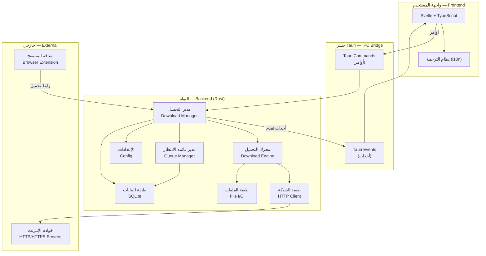
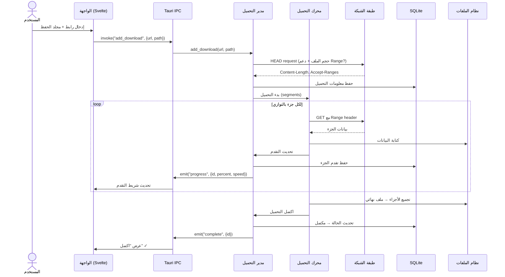

<div dir="rtl" align="right">

# الهندسة المعمارية — ARCHITECTURE.md

**الإصدار:** 0.1 (مسودة)
**الحالة:** قيد المراجعة

---

## 1. نظرة عامة

YF Download مبني على نمط **الواجهة-النواة** (Frontend-Backend):
- **النواة (Backend):** مكتوبة بـ Rust، تتعامل مع كل عمليات التحميل والشبكة وقاعدة البيانات.
- **الواجهة (Frontend):** مكتوبة بـ Svelte + TypeScript، تُعرض داخل نافذة Tauri (WebView أصلي).
- **الجسر (Bridge):** Tauri IPC — الواجهة ترسل أوامر إلى النواة وتستقبل أحداثًا منها.

</div>



<div dir="rtl" align="right">

## 2. الأجزاء الرئيسية

### 2.1 محرك التحميل (Download Engine)

القلب النابض للمشروع. مسؤول عن:

- **تقسيم الملف** إلى أجزاء (segments) بناءً على حجم الملف وعدد الاتصالات.
- **إدارة الاتصالات المتوازية** عبر tokio (async runtime).
- **استئناف التحميل** باستخدام ترويسة HTTP `Range`.
- **تجميع الأجزاء** في ملف واحد عند اكتمال التحميل.
- **إبلاغ عن التقدم** (السرعة، النسبة، الوقت المتبقي) عبر أحداث Tauri.

```
┌─────────────────────────────────────────────┐
│            محرك التحميل (Download Engine)     │
│                                             │
│  ┌─────────┐  ┌─────────┐  ┌─────────┐     │
│  │ الجزء 1 │  │ الجزء 2 │  │ الجزء N │     │
│  │ 0-25%   │  │ 25-50%  │  │ 75-100% │     │
│  └────┬────┘  └────┬────┘  └────┬────┘     │
│       │            │            │           │
│       ▼            ▼            ▼           │
│  ┌─────────────────────────────────────┐    │
│  │     تجميع الأجزاء → ملف نهائي       │    │
│  └─────────────────────────────────────┘    │
└─────────────────────────────────────────────┘
```

**التعامل مع الأخطاء:**
- فشل اتصال جزء → إعادة المحاولة (مع تأخير تصاعدي exponential backoff).
- الخادم لا يدعم Range → تحميل بدون تقسيم (اتصال واحد).
- انقطاع كامل → حفظ الحالة في SQLite واستئناف لاحقًا.

### 2.2 مدير التحميل (Download Manager)

الطبقة الوسيطة بين الواجهة والمحرك:

- يستقبل أوامر من الواجهة (إضافة تحميل، إيقاف، استئناف، حذف).
- يُنشئ مهام تحميل ويسلمها للمحرك.
- يحفظ حالة كل تحميل في قاعدة البيانات.
- يرسل أحداث التقدم إلى الواجهة.

### 2.3 مدير قائمة الانتظار (Queue Manager)

- يتحكم في عدد التحميلات النشطة في وقت واحد.
- عند اكتمال تحميل، يبدأ التالي في القائمة تلقائيًا.
- يدعم الأولويات (عالية، عادية، منخفضة).

### 2.4 طبقة البيانات (Data Layer — SQLite)

تحفظ:
- **التحميلات:** الرابط، اسم الملف، الحجم، الحالة، التقدم، الفئة.
- **الأجزاء:** أي أجزاء اكتملت وأيها لم يكتمل (للاستئناف).
- **الإعدادات:** تفضيلات المستخدم.
- **السجل:** تاريخ التحميلات المكتملة.

### 2.5 طبقة الشبكة (Network Layer)

- تستخدم مكتبة `reqwest` (مبنية على `hyper` وtokio).
- تدعم HTTP/HTTPS مع التحقق من شهادات TLS.
- تتعامل مع إعادة التوجيه (redirects) وملفات تعريف الارتباط (cookies).
- دعم الوكيل (proxy) — مخطط لمراحل لاحقة.

### 2.6 الواجهة (Frontend — Svelte + TypeScript)

- **الصفحة الرئيسية:** قائمة التحميلات مع شريط تقدم لكل تحميل.
- **نافذة إضافة تحميل:** إدخال الرابط واختيار مجلد الحفظ.
- **صفحة الإعدادات:** التحكم في التفضيلات.
- **دعم RTL:** تخطيط من اليمين لليسار للعربية، مع تبديل تلقائي عند تغيير اللغة.

### 2.7 إضافة المتصفح (Browser Extension) — مرحلة لاحقة

- إضافة خفيفة لـ Chrome/Firefox/Edge.
- تلتقط أحداث التحميل في المتصفح.
- ترسل الرابط إلى YF Download عبر Native Messaging أو HTTP محلي.

## 3. تدفق البيانات (Data Flow)

### 3.1 تحميل ملف جديد

</div>



<div dir="rtl" align="right">

### 3.2 استئناف تحميل متوقف

1. عند بدء التطبيق، يقرأ مدير التحميل من SQLite قائمة التحميلات غير المكتملة.
2. لكل تحميل غير مكتمل، يتحقق من الأجزاء المكتملة.
3. يبدأ المحرك تحميل الأجزاء المتبقية فقط (باستخدام HTTP Range).

## 4. هيكل المجلدات المخطط

```
YF-Download/
├── src-tauri/                    # نواة Rust + إعدادات Tauri
│   ├── src/
│   │   ├── main.rs              # نقطة الدخول
│   │   ├── commands/            # أوامر Tauri (IPC handlers)
│   │   ├── download/            # محرك التحميل
│   │   │   ├── engine.rs        # المحرك الرئيسي
│   │   │   ├── segment.rs       # إدارة الأجزاء
│   │   │   └── progress.rs      # تتبع التقدم
│   │   ├── queue/               # مدير قائمة الانتظار
│   │   ├── db/                  # طبقة SQLite
│   │   ├── net/                 # طبقة الشبكة
│   │   ├── config/              # الإعدادات
│   │   └── error.rs             # أنواع الأخطاء
│   ├── Cargo.toml
│   └── tauri.conf.json
├── src/                          # واجهة Svelte
│   ├── lib/
│   │   ├── components/          # مكونات UI
│   │   ├── stores/              # Svelte stores (حالة التطبيق)
│   │   ├── i18n/                # ملفات الترجمة
│   │   │   ├── ar.json          # العربية
│   │   │   └── en.json          # الإنجليزية
│   │   └── api/                 # استدعاءات Tauri IPC
│   ├── routes/                  # صفحات التطبيق
│   ├── app.html
│   └── app.css
├── docs/                         # التوثيق
├── tests/                        # اختبارات التكامل
└── browser-extension/            # إضافة المتصفح (مرحلة لاحقة)
```

## 5. التبعيات الرئيسية المتوقعة

### Rust (Backend)
| المكتبة | الغرض |
|---------|-------|
| `tauri` | إطار التطبيق + IPC |
| `tokio` | وقت تشغيل غير متزامن (async runtime) |
| `reqwest` | عميل HTTP/HTTPS |
| `rusqlite` | قاعدة بيانات SQLite |
| `serde` / `serde_json` | تسلسل البيانات (serialization) |
| `url` | تحليل الروابط والتحقق منها |
| `thiserror` | أنواع أخطاء مخصصة |

### Frontend (Svelte)
| المكتبة | الغرض |
|---------|-------|
| `@tauri-apps/api` | التواصل مع النواة عبر IPC |
| `svelte-i18n` أو ما يعادلها | الترجمة (العربية/الإنجليزية) |
| `@tauri-apps/plugin-dialog` | نوافذ اختيار المجلد |

> ⚠️ **ملاحظة:** قائمة التبعيات أولية ولم تُختبر بعد. ستُحدَّث عند بدء كتابة الكود.

</div>
